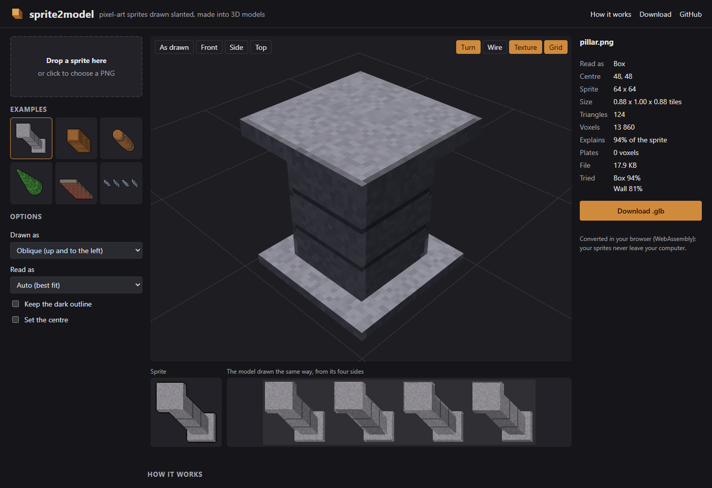
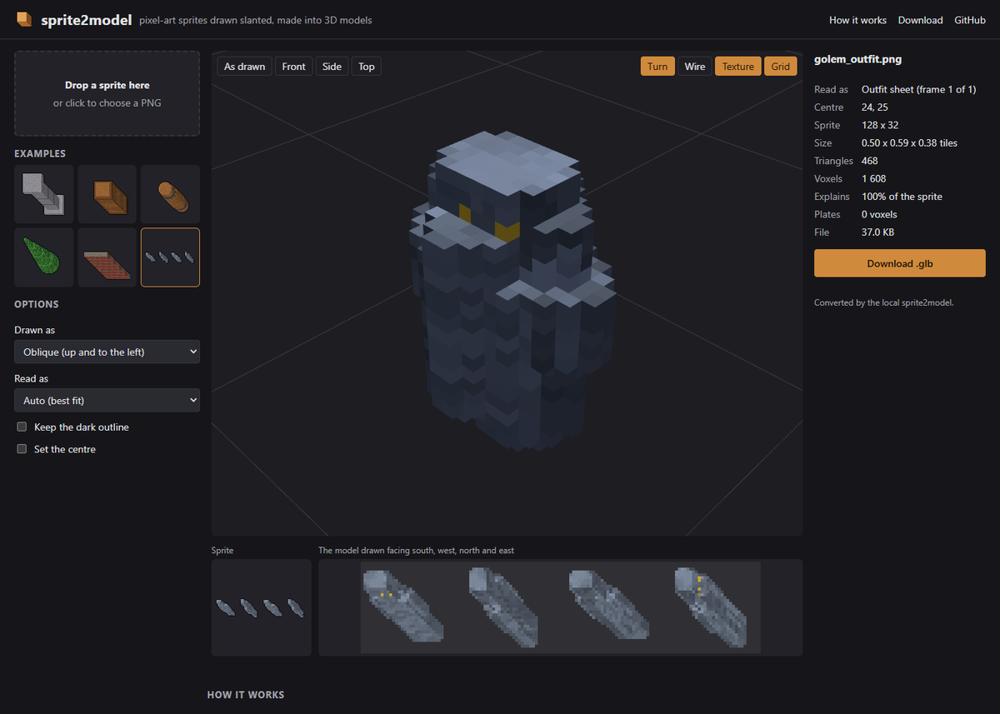

# sprite2model

Turn a pixel-art sprite drawn slanted into a textured 3D model (`.glb`): an oblique sprite (the kind
drawn with a thing's height up and to the left, as many top-down RPGs draw them), a 2:1 isometric
sprite, a creature's outfit sheet drawn facing four ways, or a weapon's inventory icon drawn flat.

**[Try it in your browser](https://coldensjo.github.io/sprite2model/)**: drop a PNG, turn the model,
download the `.glb`. The page converts on your computer (Go compiled to WebAssembly); your sprites
are not uploaded.



## How it works

A sprite is one view of a thing. Every pixel is a ray through it, and a thing anywhere along that ray
would draw the same, so the depth has to be guessed. sprite2model guesses it from what such things
usually are, carving voxels one sprite pixel wide:

| Reading | Takes the thing to be | For |
|---|---|---|
| **Box** | the same mirrored east to west and north to south, each level a box | pillars, crates, tables, wardrobes |
| **Round** | the same, each level a circle | columns, barrels, trees, rocks |
| **Wall** | the same all along its tile, east to west, north to south, or both | walls, fences, corners |
| **Cut-out** | one-sided: stood up facing you, given a rounded body behind | statues, banners, weapon racks |
| **Hull** | whatever its mirrored silhouettes allow | checking a reading |
| **Outfit sheet** | a creature drawn facing north, east, south and west, one column each | creatures, characters |
| **Item** | drawn flat, facing you: bevelled where broad, round where narrow, stood upright | swords, axes, maces, shields |
| **Auto** | the reading that explains most of the sprite | anything |

- **Box and Round**: the mirrored copies of the sprite are the thing seen from the other three
  diagonals, so they must all fall on the silhouette. That carves a visual hull, whose levels are then
  made boxes (or circles) as wide as the hull reaches along the diagonals, as long and as deep as the
  levels whose tops the sprite shows; the overhang the hull leaves over flat tops is peeled off.
- **Outfit sheet**: every direction is drawn from the same eye, so the four columns are four real
  views of the creature; the model is carved where all four see it, about the foot they agree on best.
- **Auto** tries the readings about the tile's centre and where the thing's foot is drawn, keeps the
  one that explains most of the sprite, and takes an outline with few straight runs for something
  that grew (Round, never Wall). A long sprite that no reading standing on its tile explains is taken
  for an item.
- **Item**: the outline is the sprite's, with each staircase notch filled to the diagonal, so a blade
  drawn at 45 degrees has straight edges and a one-pixel diagonal line stays joined. Each point is as
  thick as its distance from the edge and the breadth of its part say: a blade or an axe's head is
  flat and bevelled to a thin edge with a ridge, a grip or a guard's arm round. It is a smooth mesh,
  the sprite its texture front and back, turned so its long axis is upright with the greyer end (bare
  metal: the blade, the head) on top, its origin at the grip: the middle of the handle below a guard
  where one sticks out.
- Pixels a reading leaves undrawn become thin plates. Faces the sprite shows take its pixels' colours;
  hidden ones those of the same face mirrored, or of the front at the other end of their row.
- Each plane's faces are merged into rectangles and their texels packed into one texture with
  nearest filtering: a crisp, low-poly model (the example pillar is 124 triangles), one tile one
  unit, standing on its origin, y up.



## On your computer

Download `sprite2model` for Windows, Linux or macOS from the
[releases](https://github.com/Coldensjo/sprite2model/releases), or build it with Go 1.25 or later:

```sh
go install github.com/Coldensjo/sprite2model/cmd/sprite2model@latest
```

```sh
sprite2model -preview pillar.png            # pillar.glb, and pillar.preview.png: the model from four sides
sprite2model -reading round -out models *.png
sprite2model -reading outfit -frame 1 troll_outfit.png
sprite2model serve                          # the page, run locally, in your browser
```

| Flag | |
|---|---|
| `-proj tibia\|iso` | how the sprite is drawn: oblique (`x - z, y - z`, 32 pixels a tile, the sprite's bottom-right on its tile's) or 2:1 isometric |
| `-reading` | `auto` (default), `box`, `round`, `wall`, `cutout`, `hull`, `outfit` or `item` |
| `-outline` | keep the dark outline round the silhouette in the colours (left out, it takes the colours inside it) |
| `-centre x,y` | where the thing's axis meets the ground (an item's grip), in sprite pixels (default: found) |
| `-scale f` | size factor; 1 makes one tile one unit |
| `-frame n` | an outfit sheet's row (a frame of its walk), from 0 |
| `-out dir` | where to write the models (default: beside each sprite) |
| `-preview` | also write `<name>.preview.png` |

As a Go library: `spritemodel.Run(name, pngBytes, spritemodel.Options{})` gives the `.glb`, the
preview and a report.

## Building the page

```sh
GOOS=js GOARCH=wasm go build -o web/sprite2model.wasm ./cmd/wasm
cp "$(go env GOROOT)/lib/wasm/wasm_exec.js" web/
python -m http.server -d web            # then open http://localhost:8000
```

The `Page` workflow does this on every push to `main` and publishes `web/` to GitHub Pages; the
`Release` workflow attaches the command line for each platform to a `v*` tag's release. The example
sprites in `web/examples` are drawn by `go run ./cmd/examples`.

## Limits

One picture holds less than a model: what the readings guess is only as good as the guess. Things
that are neither symmetric nor one-sided (creatures from a single sprite, odd furniture) come out
rough; a sprite cut off at its foot (the top half of a two-part item) cannot stand up; small sprites
make coarse models (a 32 pixel creature is about 20 voxels tall).

## Licence

MIT. The example sprites are drawn by `cmd/examples` and are under the same licence; convert only
sprites you have the right to use.
